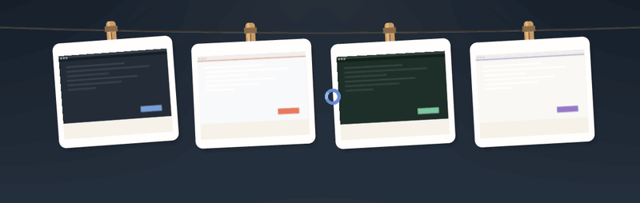

# 图墙 · PicLine

**截图，晾起来。**

按下 `Win+Shift+S` 截完，图不会落到桌面，而是夹到屏幕顶端的一根晾衣绳上。
指针往上一搭，绳子带着一排玻璃相框滑下来；单击复制、拖进聊天框、拖进文件夹；
不要了松手扔进回收站。平时它只是屏幕边缘的一条细线，不挡任何东西。

Windows 10 22H2+ / 11 · x64 · 单文件 **632 KB** · 常驻 **32 MB / 1 进程** · MIT

**[下载](#下载)** · **[手势一览](#手势)** · **[它不是什么](#它不是什么)**

| 单文件 | 常驻内存 | 进程 | 落盘 → 上墙 |
| :---: | :---: | :---: | :---: |
| **632 KB** | **32 MB** | **1** | **0.55 s** |



> 不套 Electron，不依赖 .NET、WebView2 或任何运行时——Rust + 纯 Win32/GDI+ 静态链接，
> 下载解压双击就能跑。作为对照，上一代 Electron 版实测 **416 MB / 6 进程**。

### 为什么值得装

- **截图不再变成文件。** 截完即上墙，桌面和「下载」文件夹里不再堆满
  `截图 2026-11-17 090411.png`。只有你主动拖出去的那张才会落地。
- **一条 210 px 的横带，却几乎不占地方。** 空白区域点击穿透，鼠标、滚轮、拖拽
  全部落到底下的窗口；窗口不抢焦点，不会打断你正在输入的地方。
- **用完就丢，不用整理。** 单击＝复制图片 + 文件；拖出＝发一份副本，原件还在绳上；
  拖进回收站＝删除。中间没有「归档」「整理」这一步。
- **不联网，没有账号，没有统计。** 数据全在 `%APPDATA%\图墙`，卸载也不删。

## 下载

| 文件 | 大小 | 说明 |
| --- | ---: | --- |
| [`PicLine-0.1.2-win-x64-portable.exe`](https://github.com/zy2755/picline/releases/latest) | 632 KB | 免安装单文件，双击即用，适合放 U 盘 |
| [`PicLine-0.1.2-win-x64-setup.exe`](https://github.com/zy2755/picline/releases/latest) | 550 KB | 安装版：可选目录，建桌面 / 开始菜单快捷方式 |
| [`PicLine-0.1.2-win-x64-portable.zip`](https://github.com/zy2755/picline/releases/latest) | 151 KB | 便携版压缩包，解压即用 |

- 未签名，首次运行 SmartScreen 会提示「Windows 已保护你的电脑」→ 点「更多信息」→「仍要运行」。
  校验值随 Release 附 `SHA256SUMS.txt`，可自行核对。
- 认准**本仓库的 Release 直链**。网上有同名的其他截图软件，与本项目没有关系。
- 卸载不会删除 `%APPDATA%\图墙`（你的截图还在），需要彻底清理请手动删除该目录。

## 它不是什么

它**不是** Snipaste 那类「贴图工具」，也不打算做成截图全家桶：不做截图界面、
不做 OCR、不做长截图、不做录屏、不做标注编辑器。

它只解决一件事——**截图出现之后的那几十秒**：想用的时候一伸手就有，不用的时候看不见。
标注交给系统自带的画图（长按相片直接打开）；需要深度编辑，Snipaste / PixPin 更合适；
需要把截图长期归档，资源管理器更合适。

## 手势

| 操作 | 效果 |
| --- | --- |
| 鼠标停靠屏幕顶边（中部约 56% 区域）0.25 秒 | 晾衣绳滑下 |
| 指针离开窗口 | 自动收起 |
| **单击** 相片 | 复制到剪贴板（图片 + 文件同时写入） |
| **双击** 相片 | 用系统照片查看器打开 |
| **长按** 0.45 秒 | 用画图（mspaint）编辑 |
| **拖出** 到应用 | 发送一份副本，相片留在绳上 |
| **拖出** 到文件夹 | 保存一份，相片留在绳上 |
| **右键** | 复制 / 画图编辑 / 打开 / 另存为 / 取下并保存到截图文件夹 / 删除 |
| 点 **✕** 或拖到回收站 | 移入回收站 |
| `Ctrl+Alt+T` | 手动显示 / 收起晾衣绳 |
| 托盘图标 | 开关两条截图通道、开机自启、打开收件箱 |

新截图到手的一瞬间就挂上绳，不用等任何缩略图弹窗。

## 截图从哪来

两条通道，自动去重：

1. **截图文件夹**（默认开启）：监视 `图片\Screenshots`（`Win+Shift+S`、`Win+PrintScreen`
   的落盘处）。新截图随即移入图墙的收件箱 `%APPDATA%\图墙\inbox`，原文件夹不再堆积；
   在绳上「取下并保存」会放回 `图片\Screenshots`。
2. **剪贴板**（默认开启）：捕捉不落盘的截图（关闭「自动保存原始屏幕截图」时的
   `Win+Shift+S`、各类工具的「复制到剪贴板」）。

只认**启动之后**的新内容：历史截图、云盘同步、复制图片都不会被误收；自己「单击复制」
的图也不会被再挂一次。同一张图两条通道同时到达时只挂一次，并保留原始文件画质。

## 安全区与穿透

- **全屏应用在前台时自动隐藏**，不会挡游戏、放映或远程会议。
- **不抢焦点**：悬停、点击晾衣绳都不会把你正在输入的窗口顶掉。
- **空白穿透**：这条横跨屏幕顶部、210 px 高的窗口，只有相片本身接收鼠标；
  指针在空白处时窗口是穿透的，点击、滚轮、拖拽全部落到底下的窗口。
- **跨会话保留**：重启后相片仍挂在绳上，直到你取下或删除。

## 资源占用

口径统一为**整棵进程树**（`scripts/compare-mem.sh` + `memtree.exe`，每 250 ms 采
`PROCESS_MEMORY_COUNTERS_EX` 的工作集 / 峰值 / 私有提交）：

| 场景 | Electron v0.1.1 | 本项目（Rust / Win32 + GDI+） | 降幅 |
| --- | ---: | ---: | ---: |
| S0 收起态、空收件箱 | 416.2 MB / 6 进程 | **32.1 MB / 1 进程** | 92.3% |
| S1 挂 10 张 1920×1080 | 505.0 MB / 6 进程 | **33.6 MB / 1 进程** | 93.3% |
| 峰值工作集 | 484.4 / 600.1 MB | **35.2 / 36.7 MB** | 92.7% / 93.9% |

其他实测值：截图落盘 → 挂上绳 **552 ms**（原版理论下限约 600 ms）；展开动画
**62–66 fps**（中位 63）；60 分钟长稳采样，句柄 525、线程 14 恒定，无泄漏。

> 说明：长时间运行并调用过系统文件对话框后，工作集会上到 60 MB 左右并保持平稳
> （Windows Shell 扩展加载后常驻），这是系统行为，不是泄漏。

## 运行环境

- Windows 10 22H2 / Windows 11，x64。
- 无需安装任何运行时（不依赖 .NET、VC++ 运行库、WebView2、Node.js）。
- 配置与收件箱：`%APPDATA%\图墙`。单实例运行，重复启动会唤出已有实例。

## 自己构建

只依赖 Rust（msvc target）+ Windows SDK（`rc.exe`）+ NSIS（打安装包用）。
`Cargo.toml` 里**零外部 crate**，不联网也能构建。

```bash
cargo build --release        # → target/release/picline-core.exe
bash scripts/build-dist.sh   # → dist/ 安装包 + 便携版 + SHA256SUMS
```

`scripts/` 下还有：`compare-mem.sh`（双版本内存对照）、`make-test-photos.js`
（生成测试图）、`verify-install.py`（分发物验收）。

## 与 macOS 原版的关系

创意与交互规格来自 Alejandro Buján 的 macOS 应用
[Tendedero](https://github.com/alejandrobujan/tendedero)：把截图挂在屏幕顶部的晾衣绳上。
按其 MIT LICENSE 要求，本项目使用自己的名字与图标，不沿用原作的名称与视觉资产。

Windows 上没有菜单栏，呼出区域改为顶边中部约 56%（避开最大化窗口的按钮）；
系统截图工具不暴露「关闭浮窗 / 改存目录」这类设置，改为**监视 + 移入收件箱**；
原版的系统 Markup 标注在 Windows 上对应为画图。

Windows 平台另有几个同创意的社区移植（Snapline、PicRope / 图绳、Pegline 等）。
本项目不做功能竞赛，只把「轻」做到极致：不依赖任何运行时，一个 632 KB 的文件跑完所有事。

## 已知限制

- 仅 Windows x64；多显示器与混合 DPI 场景只在单屏 + 150% 缩放下完整验证过。
- 未签名，SmartScreen 与部分安全软件可能提示（可自行校验 SHA256）。
- 不提供截图界面，截图请用 `Win+Shift+S` / `Win+PrintScreen` / 第三方工具。
- 标注走系统画图，不是内置编辑器。

## 隐私

无账号、无网络请求、无统计上报。所有数据都是本机文件。

## 许可

代码以 MIT 发布（见 `LICENSE`）。「图墙」名称与本项目图标不在该许可范围内。
Tendedero 的名称与图标归其作者 Alejandro Buján 所有。

## English

**PicLine** hangs your screenshots on a clothesline at the top of the screen. Press
`Win+Shift+S`, and the shot is pegged up instead of dumped on your desktop. Move the
cursor to the top edge and the line slides down; click to copy, drag into any app, drop
into a folder to save, drop on the recycle bin to throw away.

Native Rust + Win32/GDI+, no Electron, no .NET, no WebView2 — a single **632 KB** exe
with **~32 MB** RAM in **one** process (the previous Electron build measured 416 MB
across 6 processes). MIT licensed, fully offline, no telemetry.

Windows 10 22H2+ / 11, x64. Download from [Releases](https://github.com/zy2755/picline/releases/latest).

---

创意致敬 [Tendedero](https://github.com/alejandrobujan/tendedero)。验收与实测记录见
[`ACCEPTANCE.md`](ACCEPTANCE.md)。
